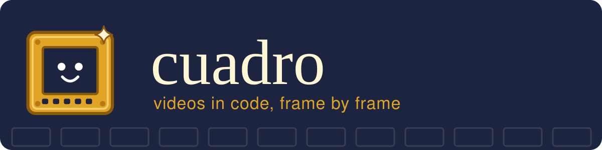

# cuadro

cuadro makes videos in code. A video is a web page drawn with
[spark](https://github.com/ldiaz94/spark), and what it shows depends on
one thing only: a `frame` signal. To render, cuadro opens the page in
headless Chromium, sets the frame, takes a screenshot, and pipes each
picture to ffmpeg, which writes an mp4. Animation helpers (`interpolate`,
`spring`, easings) and a timeline (`sequence`, `series`) are pure
functions of the frame, so the same props always give the same video. The
same page is also its own preview, with a scrubber and play button. It is
like Remotion, but on spark instead of React, written from scratch.

*Cuadro* is Spanish for "frame", and also for "picture". The mascot is a
picture frame with a face, film sprocket holes along its bottom edge, and
a spark in its corner.

> **Status: experimental (0.3).** The API may change. cuadro is not on
> npm, and nobody outside the project has reviewed it yet.

## See it


This is [`demo/video.js`](demo/video.js), rendered with `npm run demo`
and turned into a GIF by `npm run gif`. The music is made from sine waves
by [`demo/music.js`](demo/music.js), so it is free to use.

## Get it

You need Node 20.6 or newer, ffmpeg with libx264 on the `PATH`, and
Chromium. cuadro uses `$CHROMIUM` if it is set, then Playwright's own
browser (`npx playwright install chromium`), then `chromium` on the
`PATH`.

```sh
npm install github:ldiaz94/cuadro#v0.4.0
npx cuadro render video.html out.mp4
```

## Learn it

A video is an HTML page. An import map tells the browser where to find
`cuadro` and `spark`. The page then calls `composition`:

```html
<script type="importmap">{ "imports": {
  "cuadro": "/node_modules/cuadro/src/index.js",
  "spark": "/node_modules/spark/src/index.js" } }</script>
<script type="module">
  import { composition, sequence, interpolate, spring, html } from 'cuadro';

  const title = (frame) => html`<h1 style=${() => ({
    transform: `scale(${spring({ frame: frame(), fps: 30 })})` })}>Hola</h1>`;

  composition({
    width: 1280, height: 720, fps: 30, durationInFrames: 150,
    props: { color: 'navy' },
    view: (frame, props) => html`
      <main style=${() => ({ background: props.color, height: '100%',
                             opacity: interpolate(frame(), [120, 150], [1, 0]) })}>
        ${sequence(15, 135, title)(frame)}
      </main>`,
  });
</script>
```

A **view** is a function from a frame getter to anything spark can put in
a hole: `(frame) => html`...``. You pass `frame` down yourself, because
spark has no context. `sequence` and `series` take views and return
views, so they nest. Inside a sequence, the frame counts from 0.

To preview, serve the project folder with a static server that answers
byte-range requests, such as `npx serve .`, and open the page. The
browser seeks audio only in files served that way: with `python3 -m
http.server` the picture scrubs but the sound cannot follow. To render
it, run:

```sh
npx cuadro render video.html out.mp4 --props '{"color":"teal"}' --audio song.mp3
```

| API | |
|---|---|
| `composition({ width, height, fps, durationInFrames, view, props })` | Mounts `view(frame, props)` on a stage of that size. The defaults in `props` are merged with `?props=<json>` from the URL. Sets `window.cuadro`, and adds the preview bar unless the URL has `?render`. |
| `sequence(from, duration, view)` | A view that mounts `view(local)` while `from <= frame < from + duration`, with `local = frame - from`. Outside that range it unmounts, and the view's effects are disposed. |
| `series([duration, view], ...)` | Sequences played back to back. Use `Infinity` for a last clip that stays. |
| `audio(src, { volume })` | A view that plays the sound file `src` from its first frame until it unmounts or the file ends. `volume` is a gain, 1 by default. Its first frame is its sequence's frame 0: to start a sound later, give it a sequence of its own, and don't show or hide it with a condition inside a sequence. |
| `interpolate(x, inRange, outRange, { easing, extrapolate })` | Piecewise mapping over two or more increasing stops. `extrapolate` is `'clamp'` (the default) or `'extend'`, or `{ left, right }` to set each side. |
| `spring({ frame, fps, config, from, to })` | A damped spring, computed in closed form. `config` is `{ mass: 1, stiffness: 100, damping: 10 }` by default. It goes from `from` (0) to `to` (1). |
| `linear`, `ease`, `easeIn`, `easeOut`, `easeInOut`, `bezier(x1, y1, x2, y2)` | CSS's easing curves. |
| `window.cuadro.setFrame(n)` | Shows frame `n`. Resolves once fonts are loaded and every `` is decoded, and rejects if an image fails. |
| `window.cuadro.clips` | The audio clips mounted so far, as `{ src, from, until, volume }` in composition frames. |
| `window.cuadro.captions` | Subtitles as `{ start, end, text }` in seconds. When a page sets them (the player does for a script with `captions`), `render` writes them beside the mp4 as an `.srt`. |
| `render({ page, out, props, audio, root, workers, onProgress })` | From `cuadro/render`, the Node API that the CLI calls. Use it in jobs. `workers` tabs render at once (default: up to 4). |
| `still({ page, out, frames, every, props, root, columns })` | From `cuadro/render`: renders only some frames, to a PNG. One frame is the PNG itself; several are a contact sheet, `columns` across. Without `frames`, one frame every `every` seconds (2). For design checks in seconds. |
| spark's API | Re-exported, so a video needs only one import. |

### Scenes and themes

`cuadro/scenes` has nine designed scenes for an explainer video, and
`cuadro/theme` the look they share. They live in their own modules, so
their names (`title`, `steps`...) never clash with a video's own; map
them in the import map too:

```html
<script type="importmap">{ "imports": {
  "cuadro": "/node_modules/cuadro/src/index.js",
  "cuadro/theme": "/node_modules/cuadro/src/theme.js",
  "cuadro/scenes": "/node_modules/cuadro/src/scenes.js",
  "spark": "/node_modules/spark/src/index.js" } }</script>
<script type="module">
  import { composition } from 'cuadro';
  import { theme } from 'cuadro/theme';
  import { stage, play, playLength, title, stat, endCard } from 'cuadro/scenes';

  const scenes = [
    [120, title({ length: 120, kicker: 'Meet Lumen', title: 'Notes that *find you*' })],
    [150, stat({ length: 150, stats: [{ value: 82, suffix: '%', label: 'fewer repeated questions' }] })],
    [110, endCard({ length: 110, logo: 'logo.svg', line: 'Try it *today*', cta: 'Start free', url: 'lumen.example' })],
  ];
  composition({
    width: 1280, height: 720, fps: 30, durationInFrames: playLength(...scenes),
    view: (frame) => stage(theme('dark', { accent: '#ff5a36' }), play(...scenes))(frame),
  });
</script>
```

Every scene is `scene(props) => view` and takes its `length` in frames.
It splits that length into beats, so something moves for the whole
scene: a highlight walks through the items, numbers count up, a mark
sweeps under a word. Give the screen key words, not the narration. In
any text, `*words*` are marked in the accent colour and `\n` breaks the
line. Scenes fill any frame size, and a portrait frame stacks what sits
side by side. [`demo/scenes.html`](demo/scenes.html) shows them all;
add `?props={"theme":"bold"}` or `{"format":"9:16"}`.

| `cuadro/scenes` | |
|---|---|
| `title({ length, kicker, title, sub })` | A kicker, the headline word by word, then a sub line. |
| `kinetic({ length, lines, words })` | Two to four short lines, one per beat, each arriving below the last, which dims; progress bars below. |
| `stat({ length, title, stats })` | One to three `{ value, prefix, suffix, label }` numbers in rows, each counting up in its beat as a rule sweeps under it, while the others dim. |
| `steps({ length, title, items, words })` | A list of `{ title, text }` with a highlight moving down it, the current step shown large beside it. |
| `tiles({ length, title, items, words })` | Two to six `{ title, text }` tiles, with a highlight moving through them. |
| `app({ length, title, device, image, rows, words })` | A phone (or `device: 'browser'`) showing a screenshot, `image`, panned top to bottom, or two to four `{ kind, title, text }` rows, all there from the start and lit one per beat: list items and profile cards (with initials) or chat bubbles (`kind: 'sent'` or `'received'`). The camera eases in and turns toward you the whole time; the headline sits beside it, or above in portrait. |
| `quote({ length, quote, name, role, image })` | A big quote word by word, then who said it: name, role, and an avatar image or their initials, ringed by a sweep to the end. |
| `compare({ length, title, left, right, words })` | Two `{ label, items }` sides (one to four items each): the first, then the second revealed by a wipe, then the second picked as it lifts and the first dims. Stacked in portrait. |
| `words` | Optional, in kinetic, steps, tiles, app (built rows) and compare: the narration line's words from voice.json. Each beat then starts as the line says its item (a word of the line, the item's title, the row's title or the side's label, give or take an ending), not on an even beat. |
| `endCard({ length, logo, line, cta, url })` | A logo (an image URL) and a line, then a call to action and the URL from halfway, held to the last frame. |
| `stage(theme, view)` | The themed frame, with a slowly drifting glow, and `view` on top. |
| `play([length, view], ...)` | Scenes in order, each cross-fading into the next over `Fade` (12) frames. `playLength(...)` is its length. |
| `scene(length, body, { className, fadeOut })` | The frame of a scene written as code: fades and drift like the others (`fadeOut: false` for a last scene). `body(t)` gets `t.frame`, `t.enter(at)` (a spring released at frame `at`) and `t.between(a, b)` (0 to 1, eased). |
| `beats(length, n)` | `n` back-to-back `{ from, to }` frame ranges up to the fade-out. Throws if one would be under 15 frames. |

| `cuadro/theme` | |
|---|---|
| `theme(name, { accent, accent2 }, { font })` | The custom properties of `'light'` (the default), `'bold'` or `'dark'`, with a brand's `#rrggbb` accents over them; the text on the accent turns dark or light to stay readable. Pass it to `stage`, or as any element's `style`. Loads the fonts; `font`, a font file's URL, is the fallback for letters they lack. |
| `themes` | Each theme's colours and fonts. |

The properties are `--bg`, `--ink`, `--muted`, `--surface`, `--line`,
`--accent`, `--accent2` and `--on-accent` for colour; `--font-display`,
`--font-body`, `--display-weight` and `--tracking` for type; the type
scale `--t-small` (28.8 px at 720p, the smallest text), `--t-body`,
`--t-3`, `--t-2`, `--t-1`, `--t-hero` and `--t-mega`; and `--pad-x`,
`--pad-y`, `--gap` and `--radius`. Sizes are in container units of the
stage, so a code scene drawn with them scales like the rest.

| `cuadro render <page> <out.mp4>` | |
|---|---|
| `--props json` | Props merged over the composition's defaults. |
| `--audio file` | A soundtrack, cut or padded with silence to the video's length. |
| `--root dir` | The directory served to the browser (default `.`). The page must be inside it. |
| `--workers n` | Tabs rendering frames at once (default: up to 4, and no more than the CPUs). The video is the same for any `n`. |

| `cuadro still <page> <out.png>` | |
|---|---|
| `--frames 0,30,60` | The frames to render. One makes a PNG; several make one contact sheet. |
| `--every 2s` | One frame every 2 seconds (the default), when `--frames` is not given. |
| `--columns n` | Frames per row of the contact sheet (default: all, at most 4). |
| `--props json`, `--root dir` | As for render. |

Progress goes to stderr: one line that updates in a terminal, or about
ten lines when the output goes to a log.

### Narration

`cuadro voice` turns a script into one audio file per line, so the visuals
can follow the voice. The script is a list of lines; each `id` is unique
and made of letters, digits, `-` or `_`:

```json
{ "lines": [
  { "id": "hook", "text": "Stop the endless job search." },
  { "id": "stats", "text": "Referrals get people hired nine times more often." } ] }
```

```sh
ELEVENLABS_API_KEY=... npx cuadro voice script.json --provider elevenlabs --voice <id> --out voice
```

This writes `voice/<id>.<ext>` for each line and `voice/voice.json`, a
list of `{ id, file, seconds, hash, levels, words, wordsFrom }` (lengths
come from ffprobe). `levels` is the line's loudness, one 0-to-1 number
per frame. `words` says when each word is said, `{ text, start, end }`
in seconds from the line's start, and `wordsFrom` where that came from:
the provider's own timings where it has them (ElevenLabs, from its
per-character alignment), else `"estimate"`, a guess from the loudness
(Gemini, OpenAI and Qwen give none). The guess finds the pauses, puts
each at the nearest gap between words (a comma's, if it is about as
near), and spreads the words between by their length; on Gemini's voice
it lands within a word or so. A script's `language` (a BCP-47 code) goes
to the providers that take one, ElevenLabs and Qwen; the others hear it
in the text. A line is spoken again only when its text, provider, API
address, voice, model or language changes, so editing one line costs one
request; a cached line that lacks levels or words gains them with no
request. Options: `--provider` (required),
`--voice`, `--model`, `--out` (default `voice`) and `--base-url`. Progress
goes to stderr. From Node, `voice({ script, out, provider, voice, model,
baseUrl, onLine })` in `cuadro/voice` does the same.

| `--provider` | key from the environment | default model | default voice |
|---|---|---|---|
| `elevenlabs` | `ELEVENLABS_API_KEY` | `eleven_multilingual_v2` | `JBFqnCBsd6RMkjVDRZzb` |
| `gemini` | `GEMINI_API_KEY` | `gemini-3.8-flash-tts` | `Kore` |
| `openai` | `OPENAI_API_KEY`; for another server, `OPENAI_BASE_URL` and `OPENAI_COMPAT_API_KEY` (optional) | `gpt-4o-mini-tts` | `alloy` |
| `qwen` | `DASHSCOPE_API_KEY` | `qwen3-tts-flash` | `Cherry` |

`openai` also talks to any compatible server (Kokoro, Piper and others):
set `OPENAI_BASE_URL` (or `--base-url`) and pick that server's model and
voice. A server that is not `api.openai.com` gets `OPENAI_COMPAT_API_KEY`,
if set, and never `OPENAI_API_KEY`, so OpenAI's key stays with OpenAI. Qwen's speech
API is not OpenAI-compatible, hence its own adapter.

The page imports the list and sets each scene's length from it:

```js
import voice from './voice/voice.json' with { type: 'json' };
const frames = voice.lines.map((l) => Math.ceil(l.seconds * 30) + 10);
```

**Rules for a deterministic video**: draw only from `frame` and `props`.
Don't use `Date.now`, `Math.random` without a seed,
`requestAnimationFrame`, CSS animations or transitions. Load everything
the video needs before calling `composition`, except fonts and ``,
which cuadro waits for.

### Scripts

A script is a video written as data: a frame shape, a theme, a brand, optional music,
and the scenes in order, each with the line the narrator says over it. A scene is one of
the designed scenes above, with its props (no `length`: cuadro works it
out), or a code scene, a module of your own:

```json
{ "format": "16:9", "theme": "dark",
  "brand": { "accent": "#ff7a59", "logo": "logo.svg" },
  "music": "music.wav",
  "language": "en", "captions": true,
  "scenes": [
    { "type": "title", "props": { "title": "Notes that *find you*" }, "say": "Meet Lumen." },
    { "code": "scenes/wave.js", "say": "Just say it out loud, and it's saved." },
    { "type": "endCard", "props": { "line": "Try it *today*", "url": "lumen.example" }, "say": "Try Lumen free." } ] }
```

Next to it, an `index.html` with the import map runs the player, which
fetches `script.json` and `voice/voice.json`:

```html
<script type="importmap">{ "imports": {
  "cuadro": "/node_modules/cuadro/src/index.js", "cuadro/theme": "/node_modules/cuadro/src/theme.js",
  "cuadro/scenes": "/node_modules/cuadro/src/scenes.js", "cuadro/level": "/node_modules/cuadro/src/level.js",
  "cuadro/player": "/node_modules/cuadro/src/player.js", "spark": "/node_modules/spark/src/index.js" } }</script>
<script type="module">
  import { player } from 'cuadro/player';
  await player();
</script>
```

`cuadro voice script.json --provider p` speaks the `say` lines into
`voice/` (scene 1's line is `scene1`, and so on), and the player then
makes each scene as long as its line plus two thirds of a second (a
second and a half for the last), never shorter than 2 seconds or than
its beats need. Without `voice/voice.json`, each type has its own length
(4 to 6 seconds). The player plays each line from its scene's first
frame and cross-fades the scenes with `play()`. `music` plays from the
first frame at a fifth of its volume (`MusicVolume`), under the narration,
and the render cuts or pads it to the video's length. Paths in the script are
relative to `script.json`. Render it like any page:
`npx cuadro render index.html out.mp4`.

`format` is `"16:9"` (the default, 1280×720) or `"9:16"` (720×1280, for
phones). The page's props override it, so one script renders in both
shapes: `npx cuadro render index.html tall.mp4 --props
'{"format":"9:16"}'` (and the same for `still`, or `?props=` in the
preview). A flag of its own would only be a second spelling of that.
Portrait is 720 wide rather than 1080 because every size is in container
units: 720×1280 has the same pixels as 1280×720, so it renders as fast,
and the smallest text is still 28.8 px.

The player hands kinetic, steps, tiles, app and compare their line's
words, so a step lights up as the narrator names it. A code scene's
module exports a function that takes `{ length, levels, words, say, fps,
format }` and returns a view, usually built with `scene()`. `levels` is
its line's loudness from voice.json, one number per frame, for
`level(levels, frame)`, and `words` its words, for `word(words, frame,
fps)`, the index of the word being said (both from `cuadro/level`).
[`demo/script`](demo/script) is a whole script with one code
scene, [`scenes/wave.js`](demo/script/scenes/wave.js).

`captions: true` shows the narration at the bottom of the frame, a
phrase at a time (cut after punctuation or at a pause, one line of at
most 38 characters), with the word being said in the theme's accent, on
a dark backdrop, at 39 px on a 720p frame. The scenes keep above that
band. Render then also writes `out.srt` beside `out.mp4`, from the same
timings. In a page of your own, `captions(words)` from `cuadro/captions`
is the view (draw it inside `stage`, and give the stage `'--safe-bottom':
CaptionBand` so the scenes keep clear), and `cues(words)` the phrases.

`language` names the language the script is written in. The bundled
fonts draw Latin-1 only (English, Spanish, Portuguese, French, German,
Italian, Dutch and the like). A script with other letters on screen (or
in its lines, with captions), say Greek, Cyrillic, Polish, Japanese,
Arabic or Hindi, fails the check, naming the first such letter, unless
it names a `font`: a font file relative to `script.json`, such as a Noto
Sans woff2 for that script, which every font stack then falls back to.
So text never comes out as empty boxes, nor in whatever font the
machine has.

`check(script)` in `cuadro/script` checks a script and names the bad
path in its error: `scenes[2].props.items: expected an array`.
`player({ script, voice })` takes other paths, or `voice: null` for
none; the stage's size comes from the format.

### Make a video from a prompt

`cuadro make` asks a language model to write the script for you:

```sh
GEMINI_API_KEY=... npx cuadro make "a 30 second explainer for a bakery" --provider gemini --voice-provider gemini
```

The model gets the script format, the scene catalogue (each scene's doc
comment and props from `scenes.d.ts`, its limits from the checker), the
themes, and the code-scene contract, and replies with `script.json` and
a module for each code scene. It is told to open with a hook, to put any
number in a stat scene, to show the product in an app scene, a
testimonial in a quote and a before/after in a compare, to vary the layouts, to show key words rather
than the narration, and to write code only for what the designed scenes
cannot show. cuadro checks the
script, writes it with an `index.html` into `--out` (default
`make-out`, a folder inside the working directory), speaks its lines if
there is a `--voice-provider`, and opens it in Chromium. A schema error,
a page error, a failed frame, or a step that takes over 30 seconds goes
back to the model to fix. A script that runs is sent back as stills
for review, one per designed scene and three per code scene, with the bar
"would a viewer notice this?": the model answers `OK`, or a numbered list
of visible defects and a better script; a review request that fails is
asked once more. It stops at `OK`, when a review lists the same defects
as the one before, or after `--rounds` revisions (default 3), and keeps the last script that ran,
also when a later reply or request fails. Progress goes to stderr, a line
as each request starts; at the end it says how to preview and render the
result. If the model never said `OK` to the script it kept (the review
failed, repeated itself, or the rounds ran out), it says so and exits
with status 3.

`--logo file`, `--brand "#rrggbb[,#rrggbb]"` and `--music file` give
the brand: the files are copied into the output folder as `logo.<ext>`
and `music.<ext>`, and cuadro sets `brand` and `music` over every draft,
so the model cannot drop them. The end card shows the logo.
`--language es` has the model write the lines and the text on screen in
that language, and sets the script's `language`, so the voice gets it
too. `--format 9:16` asks for a portrait video: the script gets that
format, and the model is told its stage is 720×1280.

The model's code runs on your machine, so the check keeps it in a small
box: cuadro's server hands the page only the output folder, cuadro and
spark, and the tab may not load anything from another origin.

| `--provider` | key from the environment | default model |
|---|---|---|
| `anthropic` | `ANTHROPIC_API_KEY` | `claude-opus-5-5` |
| `gemini` | `GEMINI_API_KEY` | `gemini-4-hydrogen` |
| `openai` | `OPENAI_API_KEY`; for another server, `OPENAI_BASE_URL` and `OPENAI_COMPAT_API_KEY` (optional) | `gpt-6.2-astra` |

`--model` picks another model and `--base-url` another server. With
`--voice-provider p` (and `--voice v`), `cuadro voice` speaks the `say`
lines into `<out>/voice` on every round (unchanged lines are not spoken
again), so the scenes follow the lines' lengths. From Node, `make({
prompt, provider, model, baseUrl, out, rounds, root, voiceProvider,
voice, logo, brand: { accent, accent2 }, music, language, format, timeout, onStep })` in `cuadro/make` does the same, and resolves
to `{ page, file, reviewed }`, `file` being `script.json`.

The result is a script: read it, edit it and commit it like any other.
Every round is a paid request to the provider, and narration also pays
for speech.

### Translate a script

```sh
GEMINI_API_KEY=... npx cuadro translate script.json --to es --provider gemini
npx cuadro voice script.es.json --provider gemini --out voice.es
```

`translate` sends the model the `say` lines and the designed scenes'
text in one request, and writes `script.es.json` beside the script with
the translations in place and `language` set. The rest stays as it is:
the structure, the brand, numbers, logos, and the code scenes (only
their lines are translated, not what they draw). The model is told to
keep screen texts short, keep the `*marks*`, and word a screen text the
way the line says it, so steps and tiles still light up on the spoken
word. Play it with `player({ script: 'script.es.json', voice:
'voice.es/voice.json' })`. It takes `--provider`, `--model` and
`--base-url` as `make` does; from Node, `translate({ script, to,
provider, model, baseUrl })` in `cuadro/translate` resolves to the new
file's path.

## How it works

Twelve ideas, a module each:

1. **Time is a signal** ([`src/composition.js`](src/composition.js)). The
   composition owns `frame`, and everything drawn is computed from it.
   spark updates the DOM synchronously on each write, so after
   `setFrame(n)` the page is already showing frame n. The only thing left
   to wait for is fonts and images.
2. **Animation is arithmetic** ([`src/animate.js`](src/animate.js)).
   `interpolate` and the easings are plain maths on the frame number.
   `spring` uses the closed-form solution of a damped oscillator instead
   of stepping through time, so frame 200 never depends on having drawn
   frame 199. Scrubbing and rendering out of order give the same picture.
3. **Time ranges are holes** ([`src/timeline.js`](src/timeline.js)). A
   sequence is a spark function hole that reads a computed "is the frame
   in range?" flag. The hole reruns only when that flag flips. So the
   view mounts once when its range begins, updates through its own
   effects while it plays, and is disposed when the range ends.
4. **The page is the preview** ([`src/preview.js`](src/preview.js)).
   Without `?render`, the composition scales its stage to fit the window
   and adds a bar with play/pause, a scrubber and the frame number. Play
   moves the frame by the wall clock. That is fine for watching, and it
   is never used when rendering. Each mounted audio clip is an `<audio>`
   element that plays and pauses with the bar and seeks when you scrub
   (the browser seeks only in files served with byte ranges, as
   `npx serve` does and `python3 -m http.server` does not).
5. **Sound is a record** ([`src/audio.js`](src/audio.js)). An `audio`
   view draws nothing. When it mounts, it works out the composition frame
   at which its own frame is 0, and adds `{ src, from, volume }` to
   `window.cuadro.clips`. When its sequence ends, it adds `until`, the
   frame it stopped at. A render visits every frame, so by the end the
   list holds every clip that is heard.
6. **Rendering is two passes** ([`src/render.js`](src/render.js), with
   [`src/serve.js`](src/serve.js) and [`src/chromium.js`](src/chromium.js)).
   cuadro serves the root directory on a loopback port, opens the page at
   the composition's size, and loops over the frames: `setFrame(n)`, take
   a PNG screenshot, write it to ffmpeg's stdin. Writes wait when the
   pipe is full, and a page error, a failed image or a step that takes
   over 30 seconds stops the render instead of hanging it. The frames go
   to a temporary video file. A second ffmpeg run then mixes the clips
   (whose numbers are checked first, since they go into ffmpeg's filter
   graph), each delayed to its `from` and
   cut at its `until`, with `--audio` as one more clip at frame 0, and
   muxes the mix with the video copied as it is.
   With `--workers n`, n tabs of the one Chromium each take the next
   frame number, and a reorder buffer hands the frames to ffmpeg in
   order, holding back a tab that gets too far ahead. Clips need every
   frame seen in order (an `until` is set when a sequence unmounts), so an
   extra tab walks all the frames without screenshots and its clips are
   the ones mixed. `cuadro still` shows only the frames you name.
   [`bin/cuadro.js`](bin/cuadro.js) parses the command line and shows
   progress.
7. **Narration is a cache** ([`src/voice.js`](src/voice.js), with
   [`src/speech.js`](src/speech.js) and [`src/http.js`](src/http.js)).
   Each provider is a small `fetch` adapter that turns text into audio
   bytes, with its key read from the environment. `post()` and `get()`
   add a timeout and retry on 429, 5xx and network errors (waiting at
   most a minute), and their errors quote the API's message but never a
   header. `voice()` hashes provider, API address, voice, model, text
   and language for each line and skips the lines whose hash and file are
   unchanged.
8. **A prompt is a loop** ([`src/make.js`](src/make.js), with
   [`src/llm.js`](src/llm.js)). Each provider is a small `fetch` adapter
   that sends a conversation, with screenshots as PNG images, and returns
   the reply's text. `make()` keeps the whole conversation: it checks
   the model's script against the schema, writes it and its code scenes,
   speaks its lines, opens it in Chromium (on a server limited to the
   output folder and the two libraries, in a tab that may reach no
   other origin), shoots a still per scene (three for a code scene),
   and sends back either the problem or the stills for review, until
   the model says `OK`, lists the same defects twice, or the rounds run
   out. The given logo, colours and music are set over every draft. Once a script has passed,
   a later failure falls back to it. What the model learns about the scenes is read from
   `scenes.d.ts` and the checker's table, so it cannot drift from them.
9. **A scene is a schedule** ([`src/scenes.js`](src/scenes.js), with
   [`src/theme.js`](src/theme.js)). A scene cuts its length into beats
   with `beats()` and ties each motion to a beat, so a longer voice line
   gives slower beats, never a still frame. All sizes are theme
   properties in container units (`cqmin`), so one stylesheet fits every
   frame size. The fonts ship with cuadro and load as `FontFace`s when
   `theme()` runs, so `setFrame` waits for them and text never falls
   back to a system font. `play()` overlaps the scenes by 12 frames:
   the old one fades out over the first 4, the new one fades in over
   frames 3 to 9 while its first items arrive, over a backdrop that never
   stops. The last scene, the end card, does not fade out.
10. **A video is data** ([`src/script.js`](src/script.js), with
   [`src/player.js`](src/player.js)). One table lists each designed
   scene's props, limits and default length; a short checker walks
   a script against it and names the first bad path. `timing()` turns
   voice.json into scene lengths, so a scene is never shorter than its
   line. The player is the only page: it imports the code scenes, hands
   each its line's levels, and plays everything with `play()`, with the
   music as one more `audio()` clip from frame 0.
11. **Words are times** ([`src/timings.js`](src/timings.js), with
   [`src/level.js`](src/level.js)). `Intl.Segmenter` cuts a line into
   words in any language, also those written without spaces. A provider
   with timings gives each word's first and last character's time;
   otherwise the line's loudness, already measured per frame, is split
   at its pauses, each pause is pinned to the nearest gap between words
   (a comma's wins if close), and the words between pauses share the
   voiced time by their length. So the times cost no request and come
   out the same every run. In the page, `word()` is the last word started,
   and a scene's beat starts as the first word matching its item is said.
12. **Captions are phrases** ([`src/captions.js`](src/captions.js), with
   [`src/translate.js`](src/translate.js)). The player moves each line's
   words to where its scene plays, and `cues()` groups them: after a
   sentence, after a comma once three words are in, at a pause, and long
   clauses in even parts, so no word is left alone. One phrase list
   draws the overlay and becomes `window.cuadro.captions`, which render
   writes as `.srt`. A translation is one request for one JSON array of
   the script's words, put back where each came from.

## Tests

`npm test` runs `node --test`. The animation tests run in Node. The
others run in Chromium and ffmpeg against
[`test/fixture.html`](test/fixture.html), a 12-frame video.

- `interpolate`: values at, between and beyond the stops; clamp and
  extend on each side; easing applied per segment; bad ranges rejected.
  `spring`: starts at `from` and settles at `to`; overshoots only when
  underdamped; agrees with itself across the three damping regimes.
  `bezier`: matches CSS.
- `sequence` and `series`: mount and unmount at the exact boundaries;
  give the right local frame, also when nested; mount once per entry and
  dispose the view's effects on exit.
- composition: `setFrame` waits for an image that loads slowly; the
  preview's keys, scrubber and play button work.
- narration, against a fake local server (no test calls a real API): retry
  on 429 then success, giving up, and errors that show the API's message
  but not the key; each provider's URL, auth header and body; OpenAI's key
  never sent to another host; Qwen's download retried; Gemini's PCM
  wrapped as a valid WAV; a missing key; lines written, voice.json correct,
  an unchanged script making no requests, one edited line spoken alone,
  and another voice or API address speaking every line again.
- render: every frame comes out at the right size; the same props give
  identical frame checksums twice, and other props give different ones;
  audio is padded to the video's length; a page error or a broken image
  fails the render; a clip whose volume is not a number fails it before
  ffmpeg runs, and writes nothing.
- audio, against [`test/audio.html`](test/audio.html): two clips are
  heard from their frames until their sequence or file ends (measured by
  detecting silence in the mix); a clip in a sequence never reached is
  never heard; `--audio` plays together with the clips; the same input
  gives the same decoded audio twice; in the preview, a clip is an
  `<audio>` element while it is mounted, and seeks with the scrubber, and
  play at the last frame goes back to frame 0 first.
- make, against a fake model (no test calls a real API): each provider's
  URL, headers and body, with images before the text; Anthropic's
  refusal and cut-off replies; an error that leaves out the key; a
  script with a schema error sent back with its path, then one whose code
  scene throws sent back with its error, then a working one and `OK`
  (one still per designed scene and three for the code scene, the working files kept); a code scene missing
  from the reply sent back, and one named on its first line found; a
  reply with no `json` block; `out` outside the root, or the root
  itself, refused; after a passed script, a failed fix and an API error
  leave the passed files; a page that fetches `/package.json` gets a
  404 and one that fetches another origin is blocked; a frame that loops
  forever comes back as a timeout; narration speaks the `say` lines and
  the stills fall where their lengths put them.
- scripts: each kind of mistake named by its path; lines and their ids;
  lengths from voice.json, the floors, the last scene's hold, and the
  defaults without narration; the checker's table matching the props in
  `scenes.d.ts`; the player's length and clip frames from a voice.json,
  a code scene given its line's levels, and the demo script playing
  without errors; `cuadro voice` speaking a scene script's lines.

- timings: words split with their punctuation, also in Japanese; a
  pause pinned at the comma, the leading quiet skipped, a short dip not
  taken for a pause, silence spread evenly; ElevenLabs' characters turned
  into words. voice.json gets estimated words, keeps them cached, and
  regains them with no request; ElevenLabs' own times win, and the
  script's language goes to the provider and into the hash; Qwen names
  the languages it knows.
- captions: phrases cut at sentences, commas, pauses, and evenly when
  long, joined without spaces in Japanese; each up until the next; the
  `.srt` text. In the player, the phrase and the lit word at given
  frames, a code scene given its words, `window.cuadro.captions`, and
  the scenes kept above the band. Steps move to the item the narration
  names, not on even beats.
- translate, against a fake model: only the text is sent and replaced,
  the brand, logos and code scenes stay, `language` is set and
  `script.es.json` written; a reply of the wrong length fails. `make
  --language` sets it and asks for it. The checker fails letters the
  fonts lack unless a `font` is named.

- scenes: beats tile each scene up to its fade-out, none under 15
  frames, and a too-short scene is refused; `playLength` counts the
  overlaps; a brand accent gets readable text on it, and bad theme names
  and colours fail. Every tenth frame of the demo, in each format and
  theme, has no text under 28 px, nothing outside the frame, nothing
  clipped, and content spanning at least 60% of the height, centred
  within 10%.

`npm run types` type-checks the declarations against
[`test/types.ts`](test/types.ts).

## Size

Lines of code, not counting blank lines or comments, as `rloc` counts them:

| module | lines |
|---|---|
| `src/animate.js` | 56 |
| `src/timeline.js` | 18 |
| `src/composition.js` | 37 |
| `src/audio.js` | 34 |
| `src/preview.js` | 48 |
| `src/render.js` | 224 |
| `src/serve.js` | 31 |
| `src/chromium.js` | 25 |
| `src/http.js` | 46 |
| `src/speech.js` | 92 |
| `src/voice.js` | 82 |
| `src/timings.js` | 94 |
| `src/llm.js` | 90 |
| `src/make.js` | 361 |
| `src/translate.js` | 58 |
| `src/theme.js` | 58 |
| `src/scenes.js` | 305 |
| `src/script.js` | 108 |
| `src/level.js` | 12 |
| `src/captions.js` | 81 |
| `src/player.js` | 56 |
| `src/index.js` | 5 |
| `bin/cuadro.js` | 186 |
| **total** | **2107** |

`scenes.js` counts its stylesheet, about 150 lines of CSS. `make.js` counts its prompt, about 110 lines of text.

The only dependencies are spark and playwright-core, plus ffmpeg from
the system. Inter and Space Grotesk (Latin-1, 70 KB of woff2) ship in
[`src/fonts`](src/fonts) under the SIL Open Font License.

## Left out

- Parallel or distributed rendering, and Lambda or cloud rendering.
  Frames are shot one at a time: on a laptop at 720p, about 25 a second
  for a simple page and 7 for the demo, which redraws a full-screen
  gradient on every frame.
- Frame-exact embedded video clips, and transparent video.
- An embeddable React player. The preview is the page itself.
- In scenes: transitions other than cross-fades, icons, images other
  than the end card's logo, the app's screenshot and the quote's avatar,
  a square (1:1) format (the existing scenes overflow a square frame
  and would need their own layouts), and scene types no video has
  needed yet. A theme has no easing (motion
  is worked out in JS from the frame; CSS never animates) and no logo
  (cuadro waits for an ``, not a CSS image, so the logo is a prop
  of the end card).
- In `make`: writing a whole page instead of a script (0.3 did; a script
  with code scenes covers it and looks better), and editing an existing
  script.
- In scripts: music fades or ducking (the music sits at one low
  volume), and scene layouts other than one after another.
- Fonts beyond Latin-1. Greek, Cyrillic, Latin Extended, CJK, Arabic and
  Devanagari are not bundled (a subset of each would outweigh cuadro);
  name a font file with the script's `font` instead, such as Noto Sans
  JP, Arabic or Devanagari from Google Fonts (OFL). Without one, the
  check fails rather than let text fall back to whatever the machine has.
- Word times from speech recognition: whisper.cpp would need a model
  file and an alignment of what it heard with the script's words. The
  loudness estimate needs neither. Captions positioned anywhere but the
  bottom, or styled other than by the theme.
- In `translate`: what code scenes draw, and fitting the longer text of
  some languages (a long Spanish headline can overflow a kinetic scene;
  check the stills).
- Waiting on anything except fonts and ``: there is no "delay
  render" hook. CSS background images and fetched data must be ready
  before `composition` is called.

## Licence

ISC: see [LICENSE](LICENSE).
